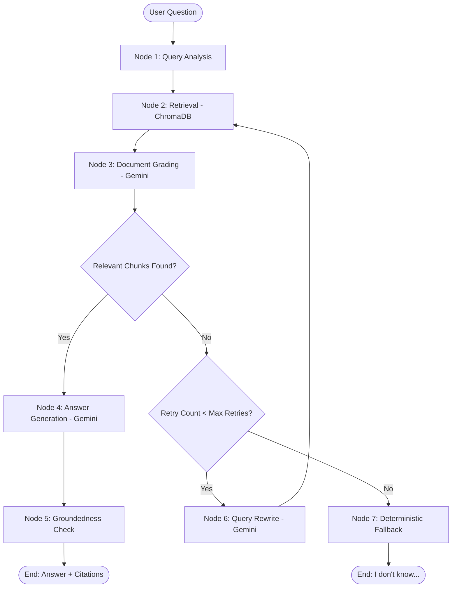

# RAG-Based Technical Documentation Assistant

An agentic Retrieval-Augmented Generation (RAG) assistant for technical documentation featuring a self-corrective **LangGraph** workflow, **FastAPI** backend, **ChromaDB** vector storage, **Sentence Transformers** local embeddings, **Google Gemini** structured outputs, and an interactive **Visual Pipeline UI**.

---

## 1. Project Overview

Technical documentation can be complex, and standard vector search often retrieves irrelevant or noisy passages. This project implements a **self-corrective, agentic RAG pipeline** that:

1. Takes a developer's question and prepares it for retrieval.
2. Performs vector similarity search across indexed technical documentation.
3. Evaluates retrieved chunks with an LLM-based **Document Grading** step.
4. **Self-corrects**: If retrieved documentation is irrelevant, the system rewrites the search query using Gemini and retries retrieval up to a configurable retry limit (`max_retries = 2`).
5. Generates grounded answers with exact source citations using only verified relevant chunks.
6. Runs a **Groundedness / Hallucination Check** to verify factuality before returning.
7. Gracefully degrades to a deterministic fallback response when the documentation does not contain the answer, avoiding hallucinations.
8. Exposes the full execution trace via a **FastAPI** service and a dedicated **Visual Pipeline UI** where evaluators can inspect every internal decision step.

The default corpus consists of official **FastAPI** documentation:
- `dependencies.md` — FastAPI Dependency Injection (`Depends()`, yields, sub-dependencies).
- `request_body.md` — Request bodies, Pydantic schemas, and validation.
- `handling_errors.md` — HTTP exceptions, custom error handlers, and status codes.

---

## 2. Architecture & Data Flow



---

## 3. LangGraph Workflow & Node Implementation

The pipeline is implemented as a stateful `StateGraph(RAGState)` in `apps/graph/workflow.py`:

| Node | Purpose | Details |
|---|---|---|
| **`query_analysis`** | Input validation & state initialization | Validates that the question is non-empty, sets `search_query`, initializes retry counters and execution trace. |
| **`retrieval`** | Vector similarity search | Encodes query using `all-MiniLM-L6-v2` and queries ChromaDB with cosine distance metric for top-5 chunks. |
| **`document_grading`** | Self-corrective relevance evaluation | Uses Gemini with structured output (`DocumentGradingOutput`) to grade every chunk as `relevant` or `irrelevant` with explicit reasoning. |
| **`route_after_grading`** | Conditional routing | Routes to `generation` if relevant chunks exist; routes to `query_rewrite` if retries remain; routes to `fallback` if retry limit is exhausted. |
| **`query_rewrite`** | Search query optimization | Uses Gemini (`QueryRewriteOutput`) to reformulate failed queries into FastAPI search keywords. Increments `retry_count`. |
| **`generation`** | Grounded answer generation | Prompts Gemini to synthesize a concise, technical response based **only** on the filtered relevant chunks, preserving source citations. |
| **`groundedness_check`** | Hallucination prevention | Evaluates whether claims in the generated response are backed by the context documents (`GroundednessCheckOutput`). |
| **`fallback`** | Graceful degradation | Deterministically returns: *"I don't know based on the available documentation. The indexed documentation does not contain sufficient information to answer this question."* |

---

## 4. Self-Correction & Retry Strategy

Standard RAG architectures suffer from **retrieval mismatch**: vector similarity can retrieve superficially close chunks that do not actually answer the user's intent.

### Self-Correction Mechanism
1. **Grading Gatekeeper**: The LLM grades each chunk independently. Irrelevant chunks are pruned from memory and never reach the generation node.
2. **Dynamic Query Rewriting**: When zero chunks are relevant (e.g. asking about Django or AWS deployment), the system prompts Gemini with the original question, previously failed queries, and the available documentation topics to generate a search-optimized query.
3. **Loop Termination Guarantee**: Retries are tracked in `RAGState["retry_count"]`. When `retry_count >= max_retries` (default `2`), the graph deterministically routes to `fallback`, completely preventing infinite loops.

---

## 5. Chunking Strategy & Embeddings

### Semantic Technical Chunking (`apps/ingestion/chunker.py`)
Technical documentation requires special handling: splitting in the middle of a Python function or code block ruins context.
- **Code Block Preservation**: Fenced code blocks (` ```python ... ``` `) are identified via regex and preserved as atomic units.
- **Paragraph Boundaries**: Prose is split at natural paragraph breaks (`\n\n`).
- **Oversized Paragraph Handling**: Units exceeding the chunk size are cleanly broken along line and word boundaries.
- **Chunk Size & Overlap**: Default chunk size is **1200 characters** with **200 characters overlap**. This guarantees that FastAPI route examples, Pydantic models, and explanatory text remain intact while preserving continuity across boundaries.

### Local Sentence Transformers (`apps/ingestion/vectorstore.py`)
- **Model**: `sentence-transformers/all-MiniLM-L6-v2` (384-dimensional dense vectors).
- **Process Singleton**: Cached via `_embedding_model` so the neural weights are loaded only once per process.
- **Offline / Local Cache Priority**: Initialized with `local_files_only=True` first, preventing DNS latency, network checks, or Hugging Face Hub downtime during query execution.
- **ChromaDB**: Persisted in `chroma_db/` using cosine distance space (`hnsw:space: "cosine"`).

---

## 6. Gemini LLM Reliability & Performance

The LLM integration (`apps/llm/client.py`) addresses real-world transient API issues (such as `httpx.RemoteProtocolError: Server disconnected without sending a response`):

1. **Singleton Client**: Cached via `@lru_cache(maxsize=1)` to avoid re-instantiating HTTP client transports.
2. **Explicit Timeout**: Configured with `types.HttpOptions(timeout=30000)` (30 seconds) to prevent queries from hanging indefinitely.
3. **Controlled Exponential Backoff**: Retries transient errors (`RemoteProtocolError`, connection disconnects, timeouts, HTTP 429 rate limits, HTTP 503 unavailable) up to 3 attempts with `initial_backoff = 1.0s` and `multiplier = 2.0`.
4. **Connection Pool Reset**: Clears the client cache (`reset_gemini_client()`) if a transport disconnect occurs so the next attempt opens a clean socket.
5. **Structured Outputs**: Uses Pydantic schemas (`response_mime_type="application/json"`, `response_schema=...`) to eliminate JSON parsing failures.

---

## 7. Citations & Metadata Preservation

Every chunk indexed in ChromaDB retains:
- `source`: The source filename (e.g. `dependencies.md`)
- `title`: Extracted document header (e.g. `FastAPI Dependencies`)
- `url`: Official canonical URL (e.g. `https://fastapi.tiangolo.com/tutorial/dependencies/`)
- `chunk_id`: Chunk index within the document

When generating an answer, the generation node extracts metadata only from the chunks that passed relevance grading. The API returns these citations in the `sources` field, and the Visual UI displays them with direct links.

---

## 8. API Specification

The FastAPI backend serves both the `/api` prefix and root paths.

### 1. `POST /query`
Submit a question to the RAG pipeline.

**Request:**
```json
{
  "question": "What does Depends do in FastAPI?"
}
```

**Response:**
```json
{
  "question": "What does Depends do in FastAPI?",
  "answer": "FastAPI's Depends function is used to declare dependencies...",
  "sources": [
    {
      "title": "FastAPI Dependencies",
      "source": "dependencies.md",
      "url": "https://fastapi.tiangolo.com/tutorial/dependencies/"
    }
  ],
  "rewritten_query": null,
  "retry_count": 0,
  "execution": {
    "original_query": "What does Depends do in FastAPI?",
    "rewritten_queries": [],
    "retrievals": [...],
    "grading": [...],
    "retry_count": 0,
    "generation_used": true,
    "fallback_used": false,
    "execution_trace": [...]
  }
}
```

### 2. `POST /ingest`
Re-index documentation or add custom content. Supports JSON payloads and multipart file uploads:

- **Upload file via multipart/form-data**: `POST /ingest` with `file=@my_documentation.md` (and optional `title`)
- **Index external URL**: `POST /ingest` with `{ "url": "https://fastapi.tiangolo.com/tutorial/query-params/" }`
- **Index raw markdown/text**: `POST /ingest` with `{ "text": "# Title\n\nContent...", "title": "My Doc", "source": "my_doc.md" }`
- **Re-index default corpus**: `POST /ingest` with `{ "force": true }` or empty body

**Response:**
```json
{
  "status": "success",
  "documents_loaded": 1,
  "chunks_created": 4,
  "total_chunks_in_database": 29
}
```

### 3. `GET /documents`
List indexed documentation files and chunk statistics.

**Response:**
```json
{
  "total_chunks": 15,
  "documents": [
    {
      "title": "FastAPI Dependencies",
      "source": "dependencies.md",
      "url": "https://fastapi.tiangolo.com/tutorial/dependencies/",
      "chunk_count": 5
    }
  ]
}
```

### 4. `POST /feedback`
Submit user feedback on generated answers.

**Request:**
```json
{
  "question": "What does Depends do in FastAPI?",
  "answer": "FastAPI's Depends function...",
  "rating": 5,
  "feedback": "Clear explanation and accurate citations."
}
```

**Response:**
```json
{
  "status": "success",
  "message": "Thank you for your feedback!"
}
```

### 5. `GET /health`
Health check endpoint returning `{"status": "healthy"}`.

---

## 9. Visual RAG Pipeline UI

The repository includes a web frontend (`frontend/index.html`, `style.css`, `app.js`) that directly visualizes the LangGraph execution trace:

- **Query Input & Quick Chips**: Pre-configured query buttons for instant testing.
- **Step 1: Query Analysis**: Displays the original query, sanitized search query, and status.
- **Step 2: Document Retrieval**: Shows candidate chunks, cosine distances, source files, and expandable text previews.
- **Step 3: Document Grading**: Displays green `✓ RELEVANT` and red `✗ IRRELEVANT` cards with Gemini's explicit relevance reasoning.
- **Step 4: LLM Query Rewrite**: Visually exposes retry loops with the robot badge `🤖`, showing the failed query, rewritten query, reasoning, and retry attempt count.
- **Step 5: Grounded Answer & Citations**: Renders technical markdown with code formatting, verified citations, and clickable documentation links.
- **Factuality & Groundedness Badge**: Highlights whether the answer passed hallucination checking.
- **Deterministic Fallback Warning**: Displays an amber warning banner when the retry limit is exhausted for out-of-domain questions.
- **Interactive Modals**: Indexed documents browser (`Docs`) and Knowledge Ingestion Modal (`Ingest`) supporting live URL fetching, drag-and-drop file uploads (`.md`, `.txt`), and default corpus re-indexing.

> [!IMPORTANT]
> The UI derives its status strictly from the **real LangGraph execution trace** returned by the server. No statuses are simulated or hardcoded.

---

## 10. Setup & Installation Guide

### Prerequisites
- Python 3.11+ (Python 3.13 supported)
- Google Gemini API key

### 1. Clone & Setup Environment
```bash
# Clone the repository
git clone <repo-url>
cd rag-doc-assistant

# Create virtual environment
python -m venv .venv

# Activate virtual environment
# Windows PowerShell:
.venv\Scripts\Activate.ps1
# Linux / macOS:
source .venv/bin/activate

# Install dependencies
pip install -r requirements.txt
```

### 2. Configure Environment Variables
Copy `.env.example` to `.env` and insert your Gemini API key:
```bash
cp .env.example .env
```
In `.env`:
```ini
GEMINI_API_KEY=your_gemini_api_key_here
GEMINI_MODEL=gemini-3.8-flash
```

### 3. Run Document Ingestion
Index the documentation corpus into ChromaDB:
```bash
python -m apps.ingestion.vectorstore
```
*(You can also trigger ingestion anytime via the web UI's **Ingest** button or `POST /ingest` endpoint).*

### 4. Run the Application
Start the FastAPI server (serves both API and frontend UI):
```bash
uvicorn apps.main:app --host 0.0.0.0 --port 8000 --reload
```

- Open your browser at **`http://localhost:8000`** to access the Visual Pipeline UI.
- Interactive Swagger API docs are available at **`http://localhost:8000/docs`**.

---

## 11. Verification & Testing

You can evaluate the complete pipeline via the Visual UI or direct API requests:

### 1. Test via Visual UI (`http://localhost:8000`)
Click any of the quick-question chips to see the real LangGraph execution trace:
- **`What does Depends do in FastAPI?`** &rarr; Shows retrieval of `dependencies.md`, grading as `✓ RELEVANT`, direct answer generation with citations.
- **`How does FastAPI validate request bodies?`** &rarr; Shows retrieval of `request_body.md`, grading as `✓ RELEVANT`, grounded generation.
- **`How do I deploy a Django application on AWS?`** &rarr; Shows retrieved chunks graded as `✗ IRRELEVANT`, triggers `🤖 Query Rewrite`, executes retry attempt, and falls back to deterministic *"I don't know..."* when retries are exhausted.

### 2. Test via cURL / HTTP Clients

```bash
# Test 1: Query endpoint (relevant)
curl -X POST http://localhost:8000/query \
  -H "Content-Type: application/json" \
  -d '{"question": "What does Depends do in FastAPI?"}'

# Test 2: Query endpoint (irrelevant with rewrite/fallback)
curl -X POST http://localhost:8000/query \
  -H "Content-Type: application/json" \
  -d '{"question": "How do I deploy a Django application on AWS?"}'

# Test 3: List indexed documents
curl http://localhost:8000/documents

# Test 4: Submit feedback
curl -X POST http://localhost:8000/feedback \
  -H "Content-Type: application/json" \
  -d '{"question": "What does Depends do in FastAPI?", "answer": "...", "rating": 5, "feedback": "Accurate citations"}'
```

---

## 12. Design Decisions & Tradeoffs

| Decision | Selection | Justification & Tradeoffs |
|---|---|---|
| **Workflow Engine** | LangGraph | StateGraph provides explicit conditional edges, retry state tracking, and clear self-correction cycles compared to rigid sequential chains. |
| **Vector Store** | ChromaDB | Runs in-process with persistent local storage, eliminating external database infrastructure while supporting cosine distance indexing. |
| **Embedding Model** | `all-MiniLM-L6-v2` | High speed, runs entirely on CPU locally with zero API rate limits or latency, producing 384-dimensional dense vectors. |
| **LLM Provider** | Google Gemini (`gemini-3.8-flash`) | Fast inference speeds, generous quotas, and native structured Pydantic schema validation. |
| **Pruning Irrelevant Chunks** | Strict Filtering | Filtering out irrelevant chunks prior to generation prevents context dilution and eliminates hallucinations caused by distractors. |
| **Deterministic Fallback** | Hardcoded Message | Rather than prompting an LLM to generate an apology (which risks hallucinating), returning a deterministic message guarantees truthfulness when documentation is insufficient. |

---

## 13. What Would Be Improved With More Time

1. **Hybrid Search (BM25 + Dense Vectors)**: Combine BM25 keyword matching with dense sentence transformer embeddings via Reciprocal Rank Fusion (RRF) to improve exact API token lookups.
2. **Web Search Fallback**: Implement Tavily/Serper search when ChromaDB documentation retries are exhausted before resorting to fallback.
3. **Multi-Turn Session Memory**: Maintain conversation history using LangGraph checkpoints (`MemorySaver`) to support follow-up questions.
4. **Streaming SSE / WebSockets**: Stream token generation and node transitions in real-time to the frontend.

